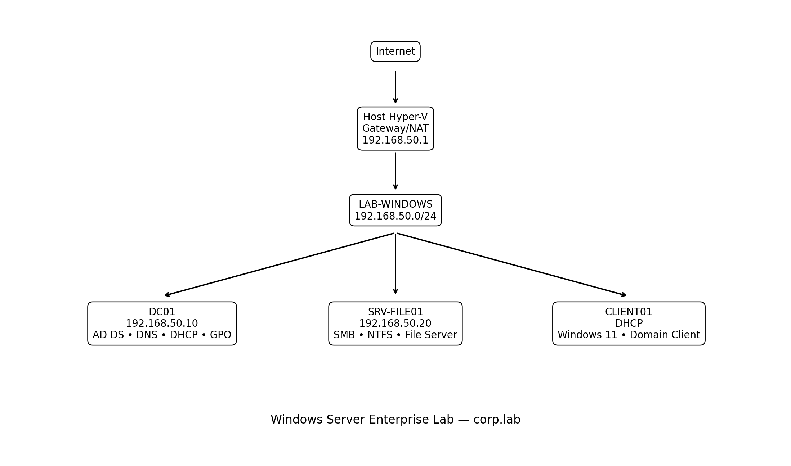

# Windows Server Enterprise Lab

Laboratório corporativo construído com **Windows Server 2022, Windows 11 e Hyper-V** para reproduzir um ambiente empresarial com Active Directory, DNS, DHCP, Group Policy, File Server, controle de acesso, auditoria e investigação de eventos de segurança.

O projeto foi desenvolvido como laboratório prático de **Infraestrutura Windows, Redes e Blue Team/SOC**, com foco em implementação, validação, troubleshooting e documentação técnica.

## Arquitetura

| Componente | Função | Endereço |
|---|---|---|
| Host Hyper-V | Virtualização, vSwitch e NAT | Gateway `192.168.50.1` |
| DC01 | AD DS, DNS, DHCP e GPO | `192.168.50.10` |
| SRV-FILE01 | File Server, SMB e NTFS | `192.168.50.20` |
| CLIENT01 | Endpoint Windows 11 ingressado no domínio | DHCP |
| Domínio | Active Directory | `corp.lab` |
| NetBIOS | Nome curto do domínio | `CORP` |
| Rede | Segmento do laboratório | `192.168.50.0/24` |



## Tecnologias e conceitos

- Windows Server 2022 Standard Evaluation
- Windows 11 Pro
- Hyper-V
- Active Directory Domain Services
- DNS Server
- DHCP Server
- Group Policy Management
- SMB
- Permissões NTFS
- PowerShell
- Modelo AGDLP
- Advanced Audit Policy
- Windows Security Log
- PowerShell Script Block Logging
- Troubleshooting de rede e domínio

## Principais implementações

- Criação do domínio `corp.lab`
- Estruturação de OUs por departamento
- Criação de usuários e grupos
- Modelo de autorização **AGDLP**
- Ingresso do `CLIENT01` e `SRV-FILE01` no domínio
- GPO de mensagem de logon
- GPO de restrição por usuário
- Mapeamento automático da unidade `T:` para o setor de TI
- File Server com compartilhamentos departamentais
- Permissões NTFS e SMB baseadas em grupos
- DHCP centralizado no DC01
- Política de senha e bloqueio de contas
- Advanced Audit Policy
- Auditoria de autenticação, contas, grupos e processos
- PowerShell Script Block Logging
- Simulação de investigação de incidente

## Estrutura do Active Directory

O laboratório utiliza as seguintes OUs:

```text
corp.lab
├── TI
├── Financeiro
├── RH
├── Comercial
├── Operacoes
├── Servidores
├── Computadores
└── Domain Controllers
```

Grupos globais de usuários:

```text
GG_TI
GG_FINANCEIRO
GG_RH
GG_COMERCIAL
GG_OPERACOES
```

Grupos Domain Local utilizados para autorização:

```text
DL_TI_RW
DL_FINANCEIRO_RW
DL_RH_RW
DL_COMERCIAL_RW
DL_OPERACOES_RW
```

Modelo:

```text
Accounts
   ↓
Global Groups
   ↓
Domain Local Groups
   ↓
Permissions
```

## Segurança e Blue Team

Durante o laboratório foram configuradas políticas de auditoria e gerados eventos controlados para análise.

| Event ID | Uso no laboratório |
|---:|---|
| 4625 | Falha de logon |
| 4688 | Criação de processo |
| 4720 | Criação de usuário |
| 4726 | Exclusão de usuário |
| 4728 | Inclusão em grupo global de segurança |
| 4729 | Remoção de grupo global de segurança |
| 4740 | Bloqueio de conta |
| 4776 | Validação de credenciais |
| 4104 | PowerShell Script Block Logging |

## Documentação

- [01 — Preparação do ambiente](docs/01-environment-setup.md)
- [02 — Configuração de rede](docs/02-network-configuration.md)
- [03 — Active Directory](docs/03-active-directory.md)
- [04 — DNS e DHCP](docs/04-dns-dhcp.md)
- [05 — Usuários e grupos](docs/05-users-groups.md)
- [06 — Group Policy](docs/06-group-policy.md)
- [07 — File Server](docs/07-file-server.md)
- [08 — Segurança e hardening](docs/08-security-hardening.md)
- [09 — Incident Response](docs/09-incident-response.md)
- [10 — Troubleshooting](docs/10-troubleshooting.md)

## Scripts

Os scripts em `scripts/` documentam e automatizam partes do laboratório. Eles foram escritos para fins educacionais e devem ser revisados antes de uso em qualquer ambiente que não seja de laboratório.

## Objetivo do projeto

Demonstrar capacidade prática em administração de infraestrutura Windows, Active Directory, redes, GPO, controle de acesso, automação com PowerShell e análise de eventos de segurança.

O foco do projeto não é apenas mostrar configurações concluídas, mas também registrar **decisões técnicas, validações, falhas encontradas e troubleshooting realizado durante a implementação**.
